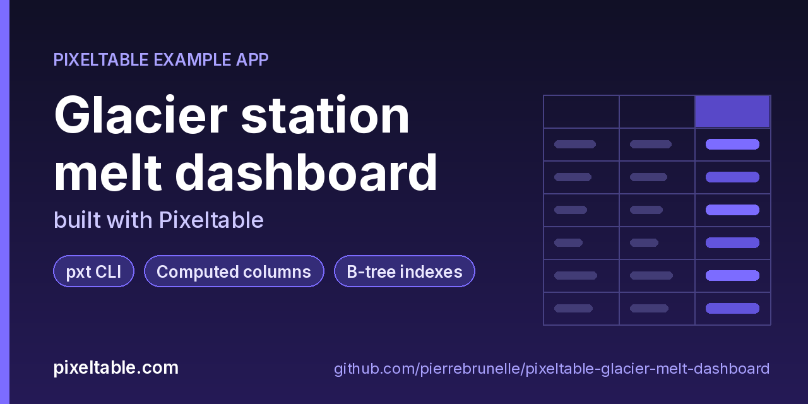

<!-- pixeltable-example-app: 20261111-glacier-melt-dashboard -->
# Glacier station melt dashboard built with Pixeltable



[](https://codespaces.new/pierrebrunelle/pixeltable-glacier-melt-dashboard?quickstart=1)
[](https://pixeltable.com)
[](https://pypi.org/project/pixeltable/)
[](https://github.com/pixeltable/pixeltable)
[](LICENSE)

Six monitoring stations on four Swiss glaciers report one row per day: air temperature, a JSON list of ablation-stake readings and sensor flags. Computed columns clean each stake list with Pixeltable's built-in JSON array functions (filter out failed stakes, map to the ablation values, sort to find the fastest-melting stake) and two small UDFs turn the result into melt, water equivalent and a melt band. dashboard.py then builds a Markdown and HTML report purely from aggregates: per-station and per-glacier count/sum/mean/min/max with group_by and a join, melt-band counts, distinct regions and stakes, and the top melt days. A debug command lists malformed readings and prints the local runtime health (pxt daemon status, pxt health, pxt status). No HTTP server.

[Pixeltable](https://pixeltable.com) is open-source, Python-native **multimodal AI data infrastructure**: tables, incremental computed columns, UDFs, indexes and serving in one library, running locally or on Pixeltable Cloud.

> ⭐ **Like this example?** Star [pixeltable/pixeltable](https://github.com/pixeltable/pixeltable) on GitHub. It helps other developers find it.

## What this example shows

- **Incremental computed columns** powered by plain Python UDFs (`@pxt.udf`)
- **B-tree indexes** declared on the model (`__indexes__`) back the lookup queries
- **Importable UDF module**: UDFs live in `udfs.py`; tables and queries live in `app.py` (Pixeltable resolves UDFs by module path)
- **`pixeltable.toml`** declares a local database and a **Pixeltable Cloud** database, so the same code deploys with `pxt db update`


## What's inside

| File | What it is |
|------|------------|
| `.devcontainer/devcontainer.json` | GitHub Codespaces / Dev Container config: Python 3.12, installs `requirements.txt` |
| `.github/social-preview.png` | Social preview image (1280x640) |
| `CITATION.cff` | Citation metadata (authors, license, release date, keywords) |
| `app.py` | Tables declared as Python classes and `@pxt.query` functions |
| `dashboard.py` | glacier: seed station readings, build a static melt dashboard, inspect runtime health |
| `data/readings.json` | Sample data |
| `data/stations.json` | Sample data |
| `pixeltable.toml` | Project config: the local database plus a Pixeltable Cloud database (sizing, deploy excludes) |
| `udfs.py` | Pixeltable UDFs (`@pxt.udf`) in their own importable module, imported by `app.py` |
| `requirements.txt` / `pyproject.toml` | Dependencies (`pixeltable>=0.7.24`) |

**Tables**

| Table | Stored columns | Computed columns |
|-------|---------|------------------|
| `stations` | `station_id`, `glacier`, `region`, `elevation_m`, `kind` | - |
| `readings` | `station_id`, `day`, `temp_c`, `stakes`, `flags` | `good_stakes`, `ablation`, `ranked`, `top_stake`, `n_ok`, `melt_cm`, `water_mm`, `band`, `n_flags` |

## Run in your browser (GitHub Codespaces)

[](https://codespaces.new/pierrebrunelle/pixeltable-glacier-melt-dashboard?quickstart=1)

1. Click **Open in GitHub Codespaces** above (or [this link](https://codespaces.new/pierrebrunelle/pixeltable-glacier-melt-dashboard?quickstart=1)). The dev container installs Python 3.12 and `pixeltable>=0.7.24` from `requirements.txt`.
2. In the codespace terminal, create the tables, seed them and run the app:

   ```bash
   pxt schema update app.py glacier
   python dashboard.py seed
   python dashboard.py build
   python dashboard.py station RHO-01
   python dashboard.py debug
   ```


## Quickstart

Requires Python 3.11+ and `pixeltable>=0.7.24`.

```bash
git clone https://github.com/pierrebrunelle/pixeltable-glacier-melt-dashboard.git
cd pixeltable-glacier-melt-dashboard
python -m venv .venv && source .venv/bin/activate
pip install -r requirements.txt

# Create the tables in a local catalog directory named `glacier`
pxt schema update app.py glacier

python dashboard.py seed
python dashboard.py build
python dashboard.py station RHO-01
python dashboard.py debug
```

## Deploy to Pixeltable Cloud

The same `app.py` runs on [Pixeltable Cloud](https://pixeltable.com). Sign in (or get a free trial database with `pxt new`), point the second database entry in `pixeltable.toml` at your own database, then deploy:

```bash
pxt login                       # or: export PIXELTABLE_API_KEY=<your-api-key>
# edit pixeltable.toml: name = 'pxt://<your-org>:<your-db>'
pxt db update pxt://<your-org>:<your-db>                 # build the image and upload the project
pxt schema update app.py pxt://<your-org>:<your-db>       # create the tables at the database root (no per-app folder)
```

Keep keys in environment variables or `pxt secret set`, never in code.

## Code walkthrough

**1. Business logic is plain Python, in `udfs.py`.** A `@pxt.udf` function can be used as a column expression. Pixeltable records UDFs by module path (`udfs.melt_band`), so they live in their own importable module rather than inline in the app: the daemon, serving workers and Pixeltable Cloud import it again by that path.

```python
# udfs.py
@pxt.udf
def melt_band(melt_cm: float | None) -> str | None:
    """Label a station-day by its mean stake ablation."""
    if melt_cm is None:
        return None
    for limit, label in BANDS:
        if melt_cm < limit:
            return label
    return "extreme"
```

**2. Tables are Python classes (`app.py`).** Annotated attributes are stored columns; attributes assigned an expression are **computed columns** (`good_stakes`, `ablation`, `ranked`, `top_stake`, `n_ok`, `melt_cm`, `water_mm`, `band`, `n_flags`), evaluated incrementally on every insert or update and recomputed when their inputs change. Indexes live next to the columns.

```python
# app.py
class Readings(TableModel, name="readings"):
    """One station-day: air temperature, ablation stakes and sensor flags."""

    station_id: pxt.String
    day: pxt.Date
    temp_c: pxt.Float | None
    stakes: pxt.Json
    flags: pxt.Json

    # Built-in JSON array functions: keep working stakes, pull their values, rank them.
    good_stakes = filter(stakes, lambda x: x.ok == True)  # noqa: E712 (expression, not a Python bool)
    ablation = map(good_stakes, lambda x: x.ablation_cm)
    ranked = sort(good_stakes, key=lambda x: x.ablation_cm, asc=False)
    top_stake = ranked[0].stake.astype(pxt.String | None)
    n_ok = good_stakes.len().astype(pxt.Int | None)
    melt_cm = mean_of(ablation)
    water_mm = water_equivalent_mm(melt_cm)
    band = melt_band(melt_cm)
    n_flags = flags.len().astype(pxt.Int | None)

    __indexes__ = [pxt.BtreeIndex(station_id), pxt.BtreeIndex(day)]
```

## Learn more

- 🌐 Website: https://pixeltable.com
- 📚 Docs: https://docs.pixeltable.com
- 💻 Source: https://github.com/pixeltable/pixeltable (⭐ star it if Pixeltable is useful to you)
- 📦 PyPI: https://pypi.org/project/pixeltable/
- 🧩 More example apps: https://pierrebrunelle.github.io/awesome-pixeltable-apps/

**[More Pixeltable example apps →](https://pierrebrunelle.github.io/awesome-pixeltable-apps/)**

---

<sub>Built as part of a daily series of Pixeltable example apps · Pixeltable 0.7.24 · Python, incremental computed columns · Licensed under Apache-2.0.</sub>
